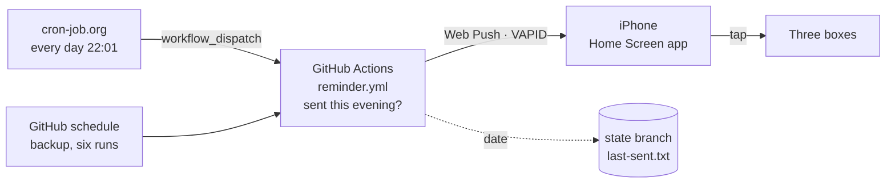

<div align="center">


# Akşam Notu

**A tiny evening note and reminder app. Every evening after 22:00, the phone gets one gentle reminder to write three lines before bed.**

*Akşam Notu is Turkish for "evening note". A companion app to [İçgörü](https://github.com/YILDIRIMZX/Piskolojik-Destek-Uygulamas-).*

**English** · [Türkçe](README.tr.md) · [Русский](README.ru.md)


</div>

## What it is

Akşam Notu turns a short evening check-in into a habit that costs a minute or two: before bed, write down the problem that is still open, the first step for tomorrow, and whether today's "alarm" went off (a recurring self-critical sentence). The next morning, the app shows last night's note first.

It is deliberately quiet. There are **no streaks, scores, warnings or guilt-inducing messages**. Every box may be left empty. The reminder comes **once a day** and can be dismissed like any notification.

> Every update, with what changed and why, is listed in [CHANGELOG.md](CHANGELOG.md).

## How the reminder works



1. **A daily trigger.** Every evening at 22:01, a free external scheduler ([cron-job.org](https://cron-job.org)) starts the workflow through the GitHub API (`workflow_dispatch` with `source: cron`). GitHub's own schedule turned out to start runs three to five hours late, so it only stays as a backup: six runs between 22:04 and 23:34, off the full hour.
2. **Once per evening, never at night.** Each run checks the date stored on a separate `state` branch and sends only if tonight's reminder has not gone out yet. Runs are serialized, so two runs can never both send. GitHub sometimes starts scheduled runs hours late, so a run sends only between 22:00 and midnight; a run that starts later does nothing.
3. **Web Push straight to the app.** The notification is a standard Web Push message signed with VAPID keys. Tapping it opens the note screen.

The decision rules live in [`.github/push/decide.mjs`](.github/push/decide.mjs) and are covered by [`decide.test.mjs`](.github/push/decide.test.mjs).

## Features

| Area | What it does |
|---|---|
| **Three boxes** | Open problem · First step tomorrow · Did the alarm go off today (yes / no, with an optional sentence). All optional. |
| **Morning view** | Between 05:00 and 17:00, last night's note is shown at the top. |
| **History** | Every note, stored by date, newest first. Empty boxes are left out. |
| **Reminder** | **Yatmadan önce üç satır** · Açıkta kalan problem, yarın atacağım ilk adım, bugün alarm çaldı mı? Once every evening after 22:00. |
| **Backup and delete** | One-tap JSON export. All notes can be deleted from the device with a two-tap confirmation. |

## Privacy and security

- **Notes never leave the device.** They are stored in the browser's IndexedDB. Nothing is uploaded, not even to GitHub. The app asks the browser for persistent storage so that notes are not cleared under storage pressure.
- **The app cannot send data anywhere.** The published page carries a Content Security Policy that allows connections only to its own address, and there are no third-party scripts, fonts or analytics. Even a faulty dependency could not send notes to another server. Links are opened without a referrer.
- **You stay in control.** All notes can be deleted in the app with a two-tap confirmation. The backup file is not encrypted, so store it with care.
- **The reminder carries no personal data.** The push payload is a fixed sentence from `push.config.json`. GitHub only stores the date of the last reminder, and the reminder times are the same fixed schedule every day.
- **Only you can send notifications to your phone.** Sending needs both the VAPID private key and the phone's subscription. Both are encrypted GitHub Actions secrets: they are never shown in logs and are not available to forks or pull requests. Starting the workflow by hand needs write access to the repository. A notification can only show text; it cannot read anything from the phone.
- **Protect the GitHub account.** Whoever controls the account could change the app's code, so turn on two-factor authentication.

## Setup

You need a GitHub account and an iPhone with iOS 16.4 or later (or any browser with Web Push).

1. **Repository and Pages.** Create a public repository, push this project, then set **Settings > Pages > Source** to **GitHub Actions**.
2. **VAPID keys.** Run `npx web-push generate-vapid-keys`. Put the public key and your `owner/repo` into [`push.config.json`](push.config.json), and save the private key as the Actions secret **`VAPID_PRIVATE_KEY`** (**Settings > Secrets and variables > Actions**).
3. **Phone.** Open the site in Safari, choose **Share > Add to Home Screen**, open the app from the Home Screen, go to **Bildirim** and tap **Bildirimleri aç**. Copy the code it shows and save it as the secret **`PUSH_SUBSCRIPTIONS`**. To add more devices, combine their codes into a JSON array.
4. **External trigger.** Create a [fine-grained token](https://github.com/settings/personal-access-tokens/new) for this repository only with **Actions: Read and write**. At [cron-job.org](https://cron-job.org), create a job that runs every day at 22:01 (time zone Europe/Istanbul) and sends POST https://api.github.com/repos/<owner>/<repo>/actions/workflows/reminder.yml/dispatches with the headers Authorization: Bearer <token>, Accept: application/vnd.github+json and Content-Type: application/json, and the body {"ref":"main","inputs":{"source":"cron"}}. GitHub answers 204 when it worked.
5. **Test.** Start **Actions > Evening reminder > Run workflow** with "test" checked. The reminder should arrive within a minute.

## Tech stack

| Layer | Technology | Version |
|---|---|---|
| UI | React | 19.3 |
| Language | TypeScript | 6.0 |
| Build | Vite | 8.3 |
| Styling | Tailwind CSS (Vite plugin) | 4.3 |
| Icons | Phosphor Icons | 2.1 |
| Typeface | Geist Variable (self-hosted via Fontsource) | 5.3 |
| PWA | vite-plugin-pwa (Workbox, injectManifest) | 2.0 |
| Storage | idb-keyval (IndexedDB) | 6.3 |
| Push | Web Push API, `web-push` (VAPID) | 3.6 |
| Scheduler and sender | GitHub Actions | |
| Hosting | GitHub Pages | |

## Project structure

```
src/
├── App.tsx                 View switch, evening rollover at 05:00
├── sw.ts                   Service worker: offline cache, push, notification tap
├── screens/
│   ├── Today.tsx           Last night's note and the three boxes
│   ├── History.tsx         All notes by date
│   ├── Settings.tsx        Notification setup and backup
│   └── NoteView.tsx        Read-only note
└── lib/
    ├── notes.ts            Storage, evening date logic, backup
    └── push.ts             Permission, subscription, test notification
.github/
├── workflows/reminder.yml  Evening schedule and sender
├── workflows/deploy.yml    Build and publish to Pages
└── push/
    ├── decide.mjs          Once per evening, 22:00-24:00 window
    ├── decide.test.mjs     Tests for the decision rules
    └── send.mjs            Web Push sender
push.config.json            Repository name, VAPID public key, reminder text
```

## Limitations

- **Depends on the external trigger.** If cron-job.org is down and GitHub's backup runs also start after midnight, that evening's reminder is skipped rather than sent at night. cron-job.org can e-mail you when a job fails.
- **Inactive repositories.** GitHub pauses scheduled workflows in public repositories after 60 days without activity. The daily update of the `state` branch normally keeps it active. If reminders stop, re-enable the workflow in the Actions tab.
- **One device, one set of notes.** Notes are not synced between devices.
- **Expired subscriptions.** If iOS drops the subscription (for example after removing the app), the workflow reports it. Turn notifications off and on in the app and paste the new code.

## Roadmap

- **Phone trigger.** If the phone is in use late at night, send the same reminder once. The workflow already accepts a `phone` source and the device's local time, so an iOS Shortcuts automation could call it while the once-a-day rule still holds.

## License

Released under the [MIT License](LICENSE). Copyright (c) 2026 Yıldırım Öztürk.
