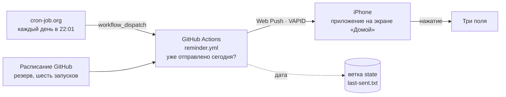

# Akşam Notu

**Маленькое приложение для вечерних заметок и напоминаний. Каждый вечер после 22:00 на телефон приходит одно мягкое напоминание написать три строки перед сном.**

*Akşam Notu по-турецки означает «вечерняя заметка». Приложение-компаньон к [İçgörü](https://github.com/YILDIRIMZX/Piskolojik-Destek-Uygulamas-).*

[English](README.md) · [Türkçe](README.tr.md) · **Русский**

## Что это

Akşam Notu превращает короткую вечернюю рефлексию в привычку на минуту-две: перед сном записать нерешённую проблему, первый шаг на завтра и то, сработал ли сегодня «будильник» (повторяющаяся самокритичная фраза). Утром приложение первым показывает вчерашнюю заметку.

Оно намеренно тихое. **Нет серий, баллов, предупреждений и обвиняющих сообщений.** Любое поле можно оставить пустым. Напоминание приходит **один раз в день** и закрывается как обычное уведомление.

> Все обновления с описанием того, что и почему изменилось, перечислены в [CHANGELOG.md](CHANGELOG.md).

## Как работает напоминание

1. **Ежедневный запуск.** Каждый вечер в 22:01 бесплатный внешний планировщик ([cron-job.org](https://cron-job.org)) запускает workflow через API GitHub (`workflow_dispatch` с `source: cron`). Собственное расписание GitHub запускало задачи с опозданием на три-пять часов, поэтому оно осталось только резервом: шесть запусков с 22:04 до 23:34, смещённых от начала часа.
2. **Один раз за вечер и никогда ночью.** Каждый запуск сверяется с датой на отдельной ветке `state` и отправляет напоминание, только если сегодня его ещё не было. Запуски идут по очереди, поэтому два запуска никогда не отправят оба. GitHub иногда запускает задачи по расписанию с опозданием на часы, поэтому запуск отправляет только с 22:00 до полуночи; запуск, начавшийся позже, ничего не делает.
3. **Web Push прямо в приложение.** Уведомление — стандартное сообщение Web Push, подписанное ключами VAPID. Нажатие открывает экран заметки.

Правила принятия решения находятся в [`.github/push/decide.mjs`](.github/push/decide.mjs) и покрыты тестами в [`decide.test.mjs`](.github/push/decide.test.mjs).

## Возможности

| Раздел | Что делает |
|---|---|
| **Три поля** | Нерешённая проблема · Первый шаг завтра · Сработал ли сегодня будильник (да / нет, с необязательной фразой). Всё необязательно. |
| **Утренний вид** | С 05:00 до 17:00 вчерашняя заметка показывается сверху. |
| **История** | Все заметки по датам, новые сверху. Пустые поля не показываются. |
| **Напоминание** | **Yatmadan önce üç satır** · Açıkta kalan problem, yarın atacağım ilk adım, bugün alarm çaldı mı? Каждый вечер после 22:00, один раз. |
| **Копия и удаление** | Экспорт в JSON одним нажатием. Все заметки можно удалить с устройства с подтверждением в два нажатия. |

## Конфиденциальность и безопасность

- **Заметки не покидают устройство.** Они хранятся в IndexedDB браузера и никуда не загружаются, даже на GitHub. Приложение запрашивает постоянное хранилище, чтобы заметки не удалялись при нехватке места.
- **Приложение не может никуда отправить данные.** На опубликованной странице действует Content Security Policy, разрешающая соединения только со своим адресом; сторонних скриптов, шрифтов и аналитики нет. Даже ошибочная зависимость не смогла бы отправить заметки на другой сервер. Ссылки открываются без referrer.
- **Всё под вашим контролем.** Все заметки можно удалить в приложении с подтверждением в два нажатия. Файл резервной копии не зашифрован, храните его бережно.
- **Напоминание не содержит личных данных.** Текст уведомления — фиксированная фраза из `push.config.json`. GitHub хранит только дату последнего напоминания, а время напоминаний — одно и то же фиксированное расписание каждый день.
- **Отправлять уведомления на телефон можете только вы.** Для отправки нужны и закрытый ключ VAPID, и подписка телефона. Оба хранятся как зашифрованные секреты GitHub Actions: они не появляются в логах и недоступны форкам и pull request. Для ручного запуска workflow нужен доступ на запись. Уведомление может только показать текст, оно ничего не читает с телефона.
- **Защитите аккаунт GitHub.** Тот, кто получит доступ к аккаунту, сможет изменить код приложения, поэтому включите двухфакторную аутентификацию.

## Установка

Нужны аккаунт GitHub и iPhone с iOS 16.4 или новее (или любой браузер с Web Push).

1. **Репозиторий и Pages.** Создайте публичный репозиторий, отправьте проект и выберите **Settings > Pages > Source: GitHub Actions**.
2. **Ключи VAPID.** Выполните `npx web-push generate-vapid-keys`. Впишите открытый ключ и `владелец/репозиторий` в [`push.config.json`](push.config.json), а закрытый ключ сохраните как секрет Actions **`VAPID_PRIVATE_KEY`** (**Settings > Secrets and variables > Actions**).
3. **Телефон.** Откройте сайт в Safari, выберите **Поделиться > На экран «Домой»**, откройте приложение с экрана «Домой», зайдите в **Bildirim** и нажмите **Bildirimleri aç**. Скопируйте показанный код и сохраните его как секрет **`PUSH_SUBSCRIPTIONS`**. Для нескольких устройств объедините коды в JSON-массив.
4. **Внешний запуск.** Создайте [fine-grained токен](https://github.com/settings/personal-access-tokens/new) только для этого репозитория с правом **Actions: Read and write**. На [cron-job.org](https://cron-job.org) создайте задачу, которая каждый день в 22:01 (часовой пояс Europe/Istanbul) отправляет POST https://api.github.com/repos/<владелец>/<репозиторий>/actions/workflows/reminder.yml/dispatches с заголовками Authorization: Bearer <токен>, Accept: application/vnd.github+json и Content-Type: application/json и телом {"ref":"main","inputs":{"source":"cron"}}. При успехе GitHub отвечает кодом 204.
5. **Проверка.** Запустите **Actions > Evening reminder > Run workflow** с отметкой «test». Напоминание должно прийти в течение минуты.

## Технологии

| Слой | Технология | Версия |
|---|---|---|
| Интерфейс | React | 19.3 |
| Язык | TypeScript | 6.0 |
| Сборка | Vite | 8.3 |
| Стили | Tailwind CSS (плагин Vite) | 4.3 |
| Иконки | Phosphor Icons | 2.1 |
| Шрифт | Geist Variable (через Fontsource) | 5.3 |
| PWA | vite-plugin-pwa (Workbox, injectManifest) | 2.0 |
| Хранилище | idb-keyval (IndexedDB) | 6.3 |
| Уведомления | Web Push API, `web-push` (VAPID) | 3.6 |
| Планировщик и отправка | GitHub Actions | |
| Хостинг | GitHub Pages | |

## Ограничения

- **Зависит от внешнего запуска.** Если cron-job.org не сработает, а резервные запуски GitHub тоже начнутся после полуночи, напоминание в этот вечер пропускается, а не отправляется ночью. cron-job.org может прислать письмо, если задача не выполнилась.
- **Неактивные репозитории.** GitHub приостанавливает задачи по расписанию в публичных репозиториях после 60 дней без активности. Ежедневное обновление ветки `state` обычно это предотвращает. Если напоминания прекратились, включите workflow снова на вкладке Actions.
- **Одно устройство — один набор заметок.** Заметки не синхронизируются между устройствами.
- **Устаревшие подписки.** Если iOS сбрасывает подписку (например, после удаления приложения), workflow сообщает об этом. Выключите и снова включите уведомления в приложении и вставьте новый код.

## Планы

- **Срабатывание от телефона.** Если телефоном пользуются поздно вечером, отправить то же напоминание один раз. Workflow уже принимает источник `phone` и местное время устройства, так что его может вызвать автоматизация iOS «Команды», а правило «раз в день» сохранится.

## Лицензия

Распространяется по [лицензии MIT](LICENSE). Copyright (c) 2026 Yıldırım Öztürk.
