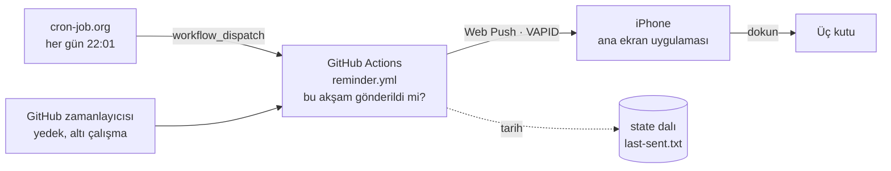

<div align="center">


# Akşam Notu

**Küçük bir akşam notu ve hatırlatma uygulaması. Her akşam 22:00'den sonra telefona, yatmadan önce üç satır yazmayı hatırlatan tek bir nazik bildirim gelir.**

*[İçgörü](https://github.com/YILDIRIMZX/Piskolojik-Destek-Uygulamas-)'nün yardımcı uygulamasıdır.*

[English](README.md) · **Türkçe** · [Русский](README.ru.md)


</div>

## Nedir

Akşam Notu, kısa bir akşam değerlendirmesini bir iki dakikalık bir alışkanlığa dönüştürür: yatmadan önce açıkta kalan problemi, yarın atılacak ilk adımı ve bugün "alarmın" (tekrarlayan öz eleştirel bir cümle) çalıp çalmadığını yazarsın. Ertesi sabah uygulama önce dün akşamki notu gösterir.

Bilerek sessiz tasarlandı. **Seri tutma, puan, uyarı ya da suçlayıcı mesaj yoktur.** Her kutu boş bırakılabilir. Hatırlatma **günde bir kez** gelir ve her bildirim gibi kapatılabilir.

> Her güncelleme, neyin neden değiştiğiyle birlikte [CHANGELOG.md](CHANGELOG.md) dosyasında yer alır.

## Hatırlatma nasıl çalışır



1. **Günlük tetikleyici.** Her akşam 22:01'de ücretsiz bir dış zamanlayıcı ([cron-job.org](https://cron-job.org)) işi GitHub API'si üzerinden başlatır (`source: cron` ile `workflow_dispatch`). GitHub'ın kendi zamanlayıcısı çalışmaları üç beş saat geç başlattığı için yalnızca yedek olarak kalıyor: 22:04 ile 23:34 arasında, tam saatten kaydırılmış altı çalışma.
2. **Akşamda bir kez, asla gece değil.** Her çalışma ayrı bir `state` dalında tutulan tarihe bakar ve yalnızca bu akşamki hatırlatma henüz gitmediyse gönderir. Çalışmalar sırayla yürür, bu yüzden iki çalışma asla ikisi birden göndermez. GitHub zamanlanmış işleri bazen saatlerce geç başlattığı için bir çalışma yalnızca 22:00 ile gece yarısı arasında gönderir; daha geç başlayan çalışma hiçbir şey yapmaz.
3. **Doğrudan uygulamaya Web Push.** Bildirim, VAPID anahtarlarıyla imzalanmış standart bir Web Push mesajıdır. Dokununca not ekranı açılır.

Karar kuralları [`.github/push/decide.mjs`](.github/push/decide.mjs) dosyasında durur ve [`decide.test.mjs`](.github/push/decide.test.mjs) ile test edilir.

## Özellikler

| Alan | Ne yapar |
|---|---|
| **Üç kutu** | Açıkta kalan problem · Yarın atacağım ilk adım · Bugün alarm çaldı mı (evet / hayır, isteğe bağlı cümleyle). Hepsi isteğe bağlı. |
| **Sabah görünümü** | 05:00 ile 17:00 arasında dün akşamki not en üstte gösterilir. |
| **Geçmiş** | Tüm notlar tarihe göre, en yenisi üstte. Boş kutular gösterilmez. |
| **Hatırlatma** | **Yatmadan önce üç satır** · Açıkta kalan problem, yarın atacağım ilk adım, bugün alarm çaldı mı? Her akşam 22:00'den sonra bir kez. |
| **Yedek ve silme** | Tek dokunuşla JSON dışa aktarma. Tüm notlar iki dokunuşluk onayla cihazdan silinebilir. |

## Gizlilik ve güvenlik

- **Notlar cihazdan çıkmaz.** Tarayıcının IndexedDB'sinde saklanır. Hiçbir yere, GitHub'a bile yüklenmez. Uygulama, notların depolama sıkışıklığında silinmemesi için tarayıcıdan kalıcı depolama ister.
- **Uygulama hiçbir yere veri gönderemez.** Yayınlanan sayfada yalnızca kendi adresine bağlantıya izin veren bir İçerik Güvenlik Politikası (CSP) vardır; üçüncü taraf betik, yazı tipi ya da analiz aracı yoktur. Hatalı bir bağımlılık bile notları başka bir sunucuya gönderemez. Bağlantılar yönlendiren bilgisi (referrer) olmadan açılır.
- **Kontrol sende.** Tüm notlar uygulamada iki dokunuşluk onayla silinebilir. Yedek dosyası şifresizdir, dikkatli sakla.
- **Hatırlatma kişisel veri taşımaz.** Bildirim içeriği `push.config.json` içindeki sabit bir cümledir. GitHub yalnızca son hatırlatmanın tarihini tutar; hatırlatma saatleri her gün aynı sabit zamanlamadır.
- **Telefonuna yalnızca sen bildirim gönderebilirsin.** Göndermek için hem VAPID özel anahtarı hem telefonun aboneliği gerekir. İkisi de şifreli GitHub Actions gizli değerleridir: kayıtlarda asla görünmez, fork'lara ve pull request'lere açılmaz. İşi elle başlatmak için repoya yazma yetkisi gerekir. Bir bildirim yalnızca yazı gösterebilir, telefondan hiçbir şey okuyamaz.
- **GitHub hesabını koru.** Hesabı ele geçiren biri uygulamanın kodunu değiştirebilir; iki adımlı doğrulamayı (2FA) aç.

## Kurulum

Bir GitHub hesabı ve iOS 16.4 veya üstü bir iPhone (ya da Web Push destekleyen herhangi bir tarayıcı) gerekir.

1. **Repo ve Pages.** Herkese açık bir repo oluştur, projeyi gönder, sonra **Settings > Pages > Source** ayarını **GitHub Actions** yap.
2. **VAPID anahtarları.** `npx web-push generate-vapid-keys` çalıştır. Açık anahtarı ve `sahip/repo` adını [`push.config.json`](push.config.json) dosyasına yaz; özel anahtarı **`VAPID_PRIVATE_KEY`** adlı Actions gizli değeri olarak kaydet (**Settings > Secrets and variables > Actions**).
3. **Telefon.** Siteyi Safari'de aç, **Paylaş > Ana Ekrana Ekle**'yi seç, uygulamayı ana ekrandan aç, **Bildirim**'e gir ve **Bildirimleri aç**'a dokun. Gösterilen kodu kopyalayıp **`PUSH_SUBSCRIPTIONS`** gizli değeri olarak kaydet. Birden fazla cihaz için kodları bir JSON dizisinde birleştir.
4. **Dış tetikleyici.** Yalnızca bu repoya erişen ve **Actions: Read and write** iznine sahip bir [ince ayarlı token](https://github.com/settings/personal-access-tokens/new) oluştur. [cron-job.org](https://cron-job.org)'da her gün 22:01'de (saat dilimi Europe/Istanbul) çalışan bir iş kur: POST https://api.github.com/repos/<sahip>/<repo>/actions/workflows/reminder.yml/dispatches adresine Authorization: Bearer <token>, Accept: application/vnd.github+json ve Content-Type: application/json başlıklarıyla {"ref":"main","inputs":{"source":"cron"}} gövdesini göndersin. Çalıştıysa GitHub 204 yanıtı verir.
5. **Test.** **Actions > Evening reminder > Run workflow**'u "test" işaretli başlat. Hatırlatma bir dakika içinde gelmeli.

## Teknoloji

| Katman | Teknoloji | Sürüm |
|---|---|---|
| Arayüz | React | 19.3 |
| Dil | TypeScript | 6.0 |
| Derleme | Vite | 8.3 |
| Stil | Tailwind CSS (Vite eklentisi) | 4.3 |
| Simgeler | Phosphor Icons | 2.1 |
| Yazı tipi | Geist Variable (Fontsource ile yerel) | 5.3 |
| PWA | vite-plugin-pwa (Workbox, injectManifest) | 2.0 |
| Depolama | idb-keyval (IndexedDB) | 6.3 |
| Bildirim | Web Push API, `web-push` (VAPID) | 3.6 |
| Zamanlayıcı ve gönderici | GitHub Actions | |
| Barındırma | GitHub Pages | |

## Proje yapısı

```
src/
├── App.tsx                 Ekran geçişi, 05:00'te akşam değişimi
├── sw.ts                   Service worker: çevrimdışı önbellek, bildirim, dokunma
├── screens/
│   ├── Today.tsx           Dünkü not ve üç kutu
│   ├── History.tsx         Tarihe göre tüm notlar
│   ├── Settings.tsx        Bildirim kurulumu ve yedek
│   └── NoteView.tsx        Salt okunur not
└── lib/
    ├── notes.ts            Depolama, akşam tarihi mantığı, yedek
    └── push.ts             İzin, abonelik, deneme bildirimi
.github/
├── workflows/reminder.yml  Akşam zamanlaması ve gönderici
├── workflows/deploy.yml    Derleyip Pages'e yayınlar
└── push/
    ├── decide.mjs          Akşamda bir kez, 22:00-24:00 aralığı
    ├── decide.test.mjs     Karar kurallarının testleri
    └── send.mjs            Web Push gönderici
push.config.json            Repo adı, VAPID açık anahtarı, hatırlatma metni
```

## Sınırlamalar

- **Dış tetikleyiciye bağlı.** cron-job.org çalışmazsa ve GitHub'ın yedek çalışmaları da gece yarısından sonra başlarsa o akşamki hatırlatma gece gönderilmek yerine atlanır. cron-job.org bir iş başarısız olunca e-posta gönderebilir.
- **Hareketsiz repolar.** GitHub, herkese açık repolarda 60 gün hareket olmazsa zamanlanmış işleri durdurur. `state` dalının günlük güncellemesi normalde repoyu hareketli tutar. Hatırlatmalar durursa işi Actions sekmesinden yeniden etkinleştir.
- **Tek cihaz, tek not seti.** Notlar cihazlar arasında eşitlenmez.
- **Süresi dolan abonelikler.** iOS aboneliği düşürürse (örneğin uygulama silinince) iş bunu bildirir. Uygulamada bildirimi kapatıp açarak yeni kodu yapıştır.

## Yol haritası

- **Telefon tetikleyicisi.** Telefon gece geç saatte kullanılıyorsa aynı hatırlatma bir kez gelsin. İş zaten `phone` kaynağını ve cihazın yerel saatini kabul ediyor; bir iOS Kestirmeler otomasyonu onu çağırabilir ve günde bir kez kuralı yine geçerli olur.

## Lisans

[MIT Lisansı](LICENSE) ile yayınlanmıştır. Telif hakkı (c) 2026 Yıldırım Öztürk.
